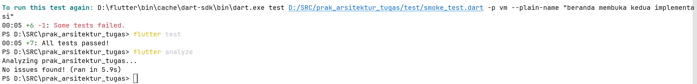
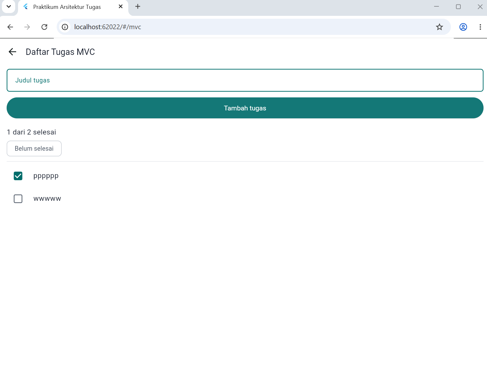
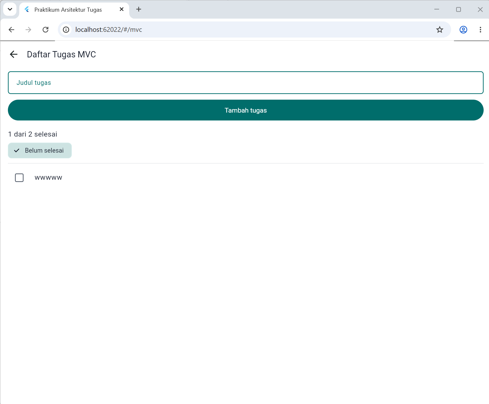
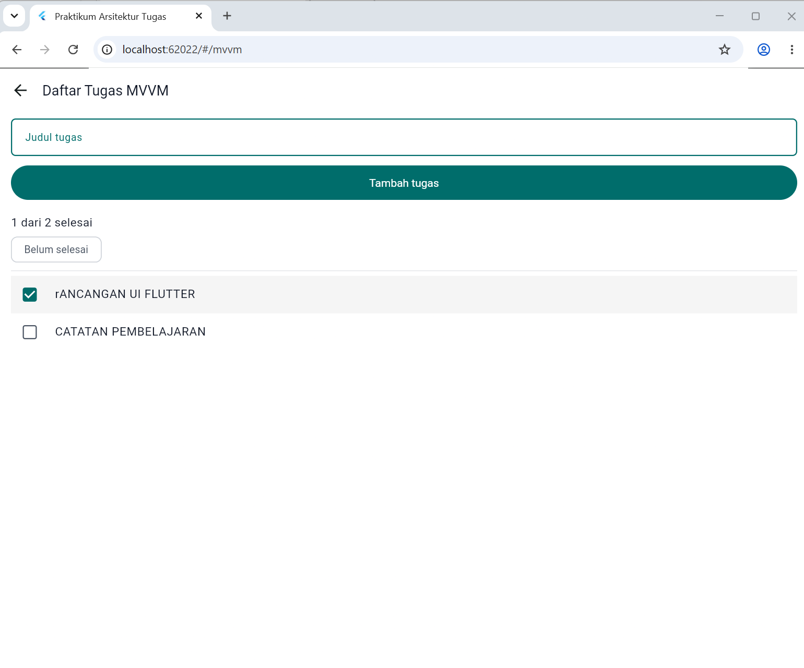
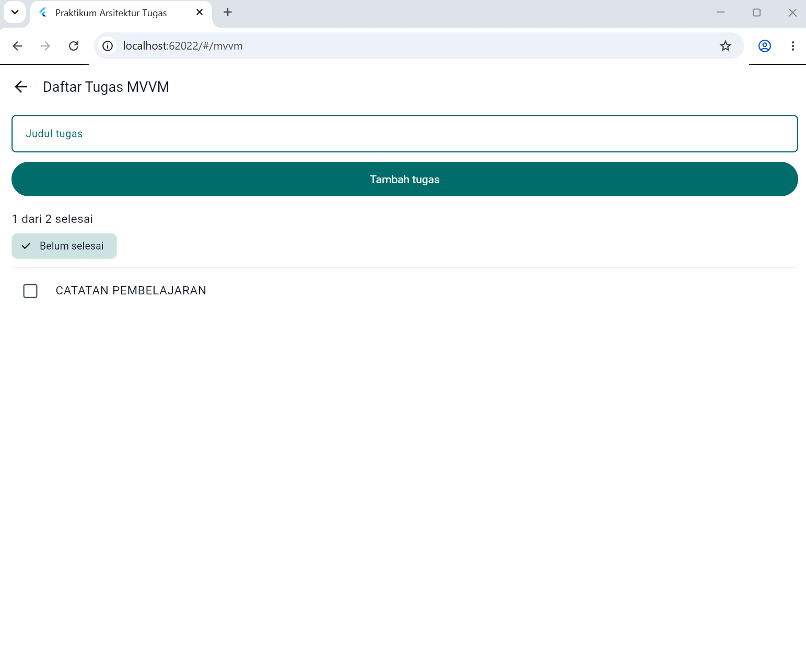

# Laporan Praktikum Mandiri: Arsitektur Aplikasi Flutter (MVC & MVVM) dan Pengujian
## 1. Identitas Mahasiswa

* **Nama Lengkap:Fa'izal harish
* **NIM:362558302082
* **Kelas:TRPL 2E
* **Tautan Repository:

---

## 2. Cara Menjalankan Aplikasi dan Pengujian

Pastikan Flutter SDK terpasang (diverifikasi pada Flutter `3.29.2`) dan jalankan perintah berikut dari folder root proyek (`prak_arsitektur_tugas`):

```bash
# 1. Mengunduh dependensi
flutter pub get

# 2. Menjalankan aplikasi pada target Web (Chrome)
flutter run -d chrome

# 3. Memeriksa analisis statis kode
flutter analyze

# 4. Menjalankan seluruh unit test dan widget test
flutter test
```
## 3. Perilaku Aplikasi & Fitur Filter "Belum selesai"
Aplikasi menyediakan dua implementasi dengan fitur yang sama (MVC dan MVVM), masing-masing mengelola data dalam memori melalui RepositoriTugas (sehingga data kembali kosong saat layar ditutup lalu dibuka kembali):

1. Tambah & Validasi Tugas: Pengguna dapat mengisi field Judul tugas (key judul-tugas) lalu menekan Tambah tugas. Judul kurang dari 4 karakter memunculkan pesan validasi "Judul minimal 4 karakter.", jumlah tugas tidak bertambah, dan input tetap tampil. Judul valid di-trim sebelum disimpan.

2. Centang & Ringkasan Tugas: Menekan checkbox pada item tugas mengubah status selesai (selesai) berdasarkan ID. Ringkasan selalu menampilkan dari selesai yang dihitung dari seluruh tugas di repository.

3. Filter Mati Saat Layar Dibuka: Pilihan filter awal bernilai false (FilterChip berlabel Belum selesai dengan key filter-belum-selesai belum terpilih) dan seluruh tugas ditampilkan.

4. Filter Dinyalakan: Hanya tugas dengan selesai == false yang tampil pada daftar yang terlihat, sementara status tugas lain tetap tersimpan di repository.

5. Tugas Dicentang Saat Filter Aktif: Tugas yang baru dicentang (selesai == true) menghilang dari daftar yang terlihat, sedangkan ringkasan jumlah selesai bertambah ( dari selesai, misalnya tetap 1 dari 2 selesai jika satu dari dua tugas selesai).

6. Filter Dimatikan Kembali: Seluruh tugas muncul kembali dan status checkbox mencerminkan kondisi terakhirnya.

7. Aturan Empty State:

    a. Jika belum ada tugas sama sekali (totalTugas == 0), tampilkan "Belum ada tugas.".

    b. Jika filter aktif dan seluruh tugas sudah selesai, tampilkan "Tidak ada tugas yang belum selesai."

## 4. Perbandingan Arsitektur (MVC vs MVVM)

### A. Ringkasan Alur Kerja dan Pemilik State

| Aspek                 | Implementasi MVC                                | Implementasi MVVM                                         |
|:----------------------|:------------------------------------------------|:----------------------------------------------------------|
| **View**              | LayarMvc (LayarMvcState) dan PanelTugas         | LayarMvvm (LayarMvvmState) dan PanelTugas                 |
| **Logika & State UI** | PengendaliTugas (lib/mvc/pengendali_tugas.dart) | TugasViewModel (lib/mvvm/tugas_view_model.dart)           |
| **Data & Repository** | RepositoriTugas dan model Tugas                 | RepositoriTugas dan model Tugas                           |
| **Pemicu Rebuild UI** | setState(() {}) pada LayarMvcState              | notifyListeners() pada TugasViewModel + ListenableBuilder |

### B. Tabel Analisis Perbandingan

| Pertanyaan                                                                      | Jawaban & Rujukan Kode                                                                                                                                                                                                                                                                                                                                                                                                                                                                                                                                                                                                                                                                                                                                                                                                                                                                                                                                                                                                                                                                   |
|:--------------------------------------------------------------------------------|:-----------------------------------------------------------------------------------------------------------------------------------------------------------------------------------------------------------------------------------------------------------------------------------------------------------------------------------------------------------------------------------------------------------------------------------------------------------------------------------------------------------------------------------------------------------------------------------------------------------------------------------------------------------------------------------------------------------------------------------------------------------------------------------------------------------------------------------------------------------------------------------------------------------------------------------------------------------------------------------------------------------------------------------------------------------------------------------------|
| **Ketika filter diketuk, class mana yang menerima aksi dan menyimpan pilihan?** | MVC: Class PengendaliTugas melalui metode aturFilter(bool nilai) setelah callback dari FilterChip diterima oleh LayarMvcState.ubahFilter(bool terpilih).<br><br>**MVVM:** Class TugasViewModel melalui metode aturFilter(bool nilai) yang dihubungkan langsung ke callback onSelected milik FilterChip pada LayarMvvmState.                                                                                                                                                                                                                                                                                                                                                                                                                                                                                                                                                                                                                                                                                                                                                              |
| **Apa yang memicu rebuild? Apa akibatnya jika pemicu itu dihapus?**             | MVC: Rebuild dipicu oleh pemanggilan setState() di dalam LayarMvcState (misalnya pada metode tambah, ubahStatus, dan ubahFilter). Jika setState() pada ubahFilter dihapus sementara, nilai _hanyaBelumSelesai tetap berubah di PengendaliTugas, namun layar maupun widget test tidak memperbarui daftar tugas yang tampil.<br><br>**MVVM:** Rebuild dipicu oleh pemanggilan notifyListeners() pada TugasViewModel yang didengarkan oleh ListenableBuilder di LayarMvvmState. Jika notifyListeners() pada ubahStatus atau aturFilter dihapus sementara, state internal berubah di ViewModel tanpa memberi sinyal ke ListenableBuilder, sehingga UI/test gagal memperbarui tampilan.<br><br>*(Catatan: Kedua pemicu rebuild sudah dipulihkan kembali setelah percobaan dilakukan).*                                                                                                                                                                                                                                                                                                        |
| **Kapan Anda memilih masing-masing pola?**                                      | MVC:<br>- **Skenario cocok:** Layar atau form sederhana dengan interaksi langsung yang sedikit (seperti alur awal tambah tugas dan centang satu layar).<br>- **Kelebihan:** Alur dari callback tombol hingga pemanggilan setState() sangat mudah ditelusuri langsung di satu file layar (LayarMvcState).<br>- **Biaya/risiko:** Mudah lupa memanggil setState() saat menambahkan aksi baru (seperti toggle filter), sehingga state di memori berubah tanpa diikuti pembaruan UI.<br><br>**MVVM:**<br>- **Skenario cocok:** Layar dengan beberapa state turunan/tampilan yang saling berkaitan, seperti daftar terfilter, ringkasan dari total keseluruhan tugas, dan pesan empty state.<br>- **Kelebihan:** Seluruh UI state dan notifikasi perubahan terpusat di TugasViewModel, sehingga dapat diuji secara menyeluruh lewat unit test (logika_test.dart) tanpa harus merender widget.<br>- **Biaya/risiko:** Membutuhkan pengelolaan lifecycle yang tepat (memanggil viewModel.dispose() di LayarMvvmState) dan disiplin memanggil notifyListeners() di setiap metode pengubah state. |

---

## 5. Hasil Percobaan Pemicu Rebuild & Keluaran Terminal

### A. Ringkasan Keluaran Terminal Setelah Kode Dipulihkan



## 5. Daftar Bukti Tangkapan Layar (`bukti/`)

Pastikan keempat tangkapan layar berikut tersimpan di folder `bukti/` dengan kondisi data yang seragam (2 tugas yang sama, 1 sudah selesai, ringkasan menunjukkan **1 dari 2 selesai**):

1.  — Layar Daftar Tugas MVC dengan chip *Belum selesai* nonaktif (2 tugas tampil, ringkasan `1 dari 2 selesai`).
2.  — Layar Daftar Tugas MVC dengan chip *Belum selesai* aktif (1 tugas belum selesai tampil, ringkasan tetap `1 dari 2 selesai`).
3.  — Layar Daftar Tugas MVVM dengan chip *Belum selesai* nonaktif (2 tugas tampil, ringkasan `1 dari 2 selesai`).
4.  — Layar Daftar Tugas MVVM dengan chip *Belum selesai* aktif (1 tugas belum selesai tampil, ringkasan tetap `1 dari 2 selesai`).